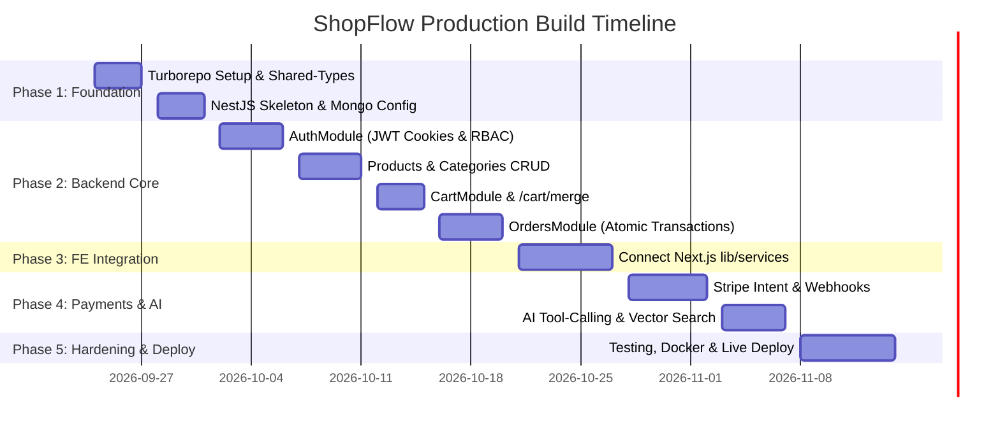

# ShopFlow: Production-Grade Single-Vendor E-Commerce Platform
## Master Engineering Specification & Implementation Roadmap

---

## 1. Executive Summary & Core Strategy

**ShopFlow** is an industry-grade, single-vendor e-commerce platform (modeled after premier brand stores like Nike or Apple). 

### Strategy
* **Preserve the Frontend**: The existing **Next.js 16 (App Router)** codebase in this workspace—including storefront pages, admin dashboard, context providers (`CartContext`, `WishlistContext`, `AuthContext`), and Zod schemas—is fully functional. We preserve and migrate this frontend into a monorepo package.
* **Build a Modular NestJS Backend**: Replace mock services (`lib/services/*`) with a high-performance **NestJS REST API** backed by **MongoDB Atlas** and **Redis**.
* **Turborepo Monorepo**: Establish a clean monorepo architecture with a `shared-types` package to synchronize DTOs, interfaces, and Zod schemas between frontend and backend.
* **Production Integrity**: Enforce atomic inventory decrements, database transactions, idempotency headers, webhook verification, and AI-native catalog search.

---

## 2. Monorepo Directory Architecture

```
Ecommerce-site/
├── apps/
│   ├── web/                         # Existing Next.js 16 Storefront & Admin Panel
│   │   ├── app/                     # App Router pages ((shop), admin)
│   │   ├── components/              # UI components, Radix/shadcn, charts
│   │   ├── context/                 # Cart, Wishlist, Auth React Contexts
│   │   ├── lib/
│   │   │   ├── api.ts               # Axios / Fetch client connecting to NestJS API
│   │   │   ├── services/            # Live API integration services
│   │   │   └── validations/         # Form validation schemas
│   │   └── package.json
│   │
│   └── api/                         # NestJS Backend Application
│       ├── src/
│       │   ├── auth/                # JWT Access + Refresh cookie rotation & RBAC
│       │   ├── users/               # Profile, addresses, account management
│       │   ├── products/            # Catalog, variants, search, stock controls
│       │   ├── categories/          # Category hierarchy & management
│       │   ├── cart/                # DB cart persistence & guest merge (/cart/merge)
│       │   ├── orders/              # Order lifecycle & atomic transactions
│       │   ├── payments/            # Stripe payment intents & idempotent webhooks
│       │   ├── reviews/             # Moderated verified-purchase review engine
│       │   ├── coupons/             # Coupon validation & discount engine
│       │   ├── ai/                  # Claude tool-calling chat & Atlas Vector Search
│       │   ├── common/              # Interceptors, guards, filters, pipes
│       │   └── main.ts
│       └── package.json
│
├── packages/
│   ├── shared-types/                # Source of truth for DTOs, Enums & Interfaces
│   │   ├── src/
│   │   │   ├── user.dto.ts
│   │   │   ├── product.dto.ts
│   │   │   ├── order.dto.ts
│   │   │   ├── cart.dto.ts
│   │   │   └── api-response.dto.ts
│   │   └── package.json
│   │
│   └── config/                      # Shared TSConfig, ESLint, Tailwind configs
│
├── docker-compose.yml               # Local infra: NestJS API, MongoDB, Redis
├── turbo.json                       # Turborepo pipeline configuration
├── PROJECT_BUILD_PLAN.md
└── package.json
```

---

## 3. Technology Stack Specification

| Layer | Technology Choice | Details & Rationale |
| :--- | :--- | :--- |
| **Frontend App** | Next.js 16 (App Router) + React 19 | Server Components for SEO, Client Components for interactive UI |
| **Frontend Styling** | Tailwind CSS v4 + Radix UI | Modern, accessible, custom design tokens |
| **State & Fetching** | TanStack Query v5 + React Context | Server caching via React Query; local UI state via React Context |
| **Backend API** | NestJS | Modular architecture, TypeScript DTOs, Dependency Injection |
| **Database** | MongoDB Atlas (Mongoose ODM) | Document storage, transactional support, vector search index |
| **Caching & Queues** | Redis + BullMQ | Read-through caching for catalog, async queue for emails/jobs |
| **Auth & Security** | JWT + Passport.js + bcrypt | Short-lived access JWT + long-lived HTTP-only refresh cookies |
| **Payments** | Stripe Payments API | Stripe Elements frontend, webhook signature verification |
| **Storage & Media** | Cloudinary | Admin image uploads with dynamic URL transformation |
| **Transactional Email** | Nodemailer / Resend | Order receipts, verification emails, password resets |
| **AI Integration** | Claude API + Atlas Vector Search | Tool-calling assistant & semantic catalog search |
| **API Documentation** | Swagger (`@nestjs/swagger`) | Auto-generated interactive API docs at `/api/docs` |

---

## 4. System Architecture Diagram

```
                              ┌───────────────────────────────┐
                              │       Next.js 16 Web App      │
                              │  (Storefront & Admin Panel)   │
                              └───────────────┬───────────────┘
                                              │ REST API / JSON (JWT Cookies)
                                              ▼
                              ┌───────────────────────────────┐
                              │          NestJS API           │
                              │      (Modular Monolith)       │
                              ├───────────────────────────────┤
                              │ AuthModule      ProductsModule│
                              │ UsersModule     CartModule    │
                              │ OrdersModule    PaymentsModule│
                              │ ReviewsModule   AdminModule   │
                              │ CouponsModule   AiModule      │
                              └───────┬───────┬───────┬───────┘
                                      │       │       │
                      ┌───────────────┘       │       └───────────────┐
                      ▼                       ▼                       ▼
            ┌──────────────────┐    ┌──────────────────┐    ┌──────────────────┐
            │  MongoDB Atlas   │    │  Redis + BullMQ  │    │  Stripe Gateway  │
            │ (Docs & Vectors) │    │  (Cache & Queue) │    │  (Webhooks/COD)  │
            └──────────────────┘    └──────────────────┘    └──────────────────┘
```

---

## 5. MongoDB Database Schemas (Mongoose Models)

### `users` Collection
```typescript
{
  _id: ObjectId,
  name: String,
  email: { type: String, unique: true, index: true },
  passwordHash: String,
  role: { type: String, enum: ['customer', 'admin'], default: 'customer' },
  isEmailVerified: { type: Boolean, default: false },
  refreshTokenHash: String, // Rotated hashed refresh token
  addresses: [{
    label: String,
    fullName: String,
    phone: String,
    line1: String,
    line2: String,
    city: String,
    state: String,
    postalCode: String,
    country: String,
    isDefault: Boolean
  }],
  wishlist: [{ type: ObjectId, ref: 'Product' }],
  createdAt: Date,
  updatedAt: Date
}
```

### `products` Collection
```typescript
{
  _id: ObjectId,
  name: String,
  slug: { type: String, unique: true, index: true },
  description: String,
  brand: String,
  categoryId: { type: ObjectId, ref: 'Category', index: true },
  price: Number,          // Minor units (cents) to avoid float issues
  discountPrice: Number,
  images: [String],
  variants: [{
    sku: { type: String, unique: true },
    size: String,
    color: String,
    stock: Number,
    price: Number
  }],
  totalStock: Number,
  ratingAvg: { type: Number, default: 0 },
  ratingCount: { type: Number, default: 0 },
  status: { type: String, enum: ['active', 'draft', 'archived'], default: 'active' },
  featured: { type: Boolean, default: false },
  tags: [String],
  embedding: [Number],    // 1536-dim vector embedding for semantic search
  createdAt: Date,
  updatedAt: Date
}
```

### `categories` Collection
```typescript
{
  _id: ObjectId,
  name: String,
  slug: { type: String, unique: true, index: true },
  parentCategoryId: { type: ObjectId, ref: 'Category', default: null },
  image: String,
  productCount: { type: Number, default: 0 }
}
```

### `carts` Collection
```typescript
{
  _id: ObjectId,
  userId: { type: ObjectId, ref: 'User', index: true, sparse: true },
  sessionId: { type: String, index: true, sparse: true }, // For guest carts
  items: [{
    productId: { type: ObjectId, ref: 'Product' },
    variantSku: String,
    quantity: Number,
    priceAtAdd: Number
  }],
  updatedAt: { type: Date, expires: '14d' } // TTL index auto-expires guest carts
}
```

### `orders` Collection
```typescript
{
  _id: ObjectId,
  orderNumber: { type: String, unique: true, index: true },
  userId: { type: ObjectId, ref: 'User', index: true },
  items: [{
    productId: ObjectId,
    variantSku: String,
    name: String,
    price: Number,
    quantity: Number,
    image: String
  }],
  shippingAddress: Object,
  subtotal: Number,       // Server-recomputed
  shippingCost: Number,   // Server-recomputed
  tax: Number,            // Server-recomputed
  discount: Number,       // Server-recomputed
  total: Number,          // Server-recomputed
  paymentMethod: { type: String, enum: ['stripe', 'cod'] },
  paymentStatus: { type: String, enum: ['pending', 'paid', 'failed', 'refunded'], default: 'pending' },
  paymentIntentId: { type: String, index: true, sparse: true },
  orderStatus: { type: String, enum: ['pending', 'confirmed', 'processing', 'shipped', 'delivered', 'cancelled'], default: 'pending' },
  statusHistory: [{ status: String, timestamp: Date, note: String }],
  createdAt: Date,
  updatedAt: Date
}
```

---

## 6. Complete REST API Specifications

### Auth Endpoints
* `POST /auth/register` — Register user & issue email verification token.
* `POST /auth/login` — Authenticate & set HTTP-only refresh cookie + return short-lived access JWT.
* `POST /auth/refresh` — Rotate refresh token & return new access token.
* `POST /auth/logout` — Revoke refresh token & clear HTTP-only cookie.
* `POST /auth/forgot-password` — Send reset password email token.
* `POST /auth/reset-password` — Update password with token verification.

### Products Catalog Endpoints
* `GET /products` — Query catalog with pagination (`page`, `limit`), search (`search`), category (`category`), price range (`minPrice`, `maxPrice`), and sorting (`sort`).
* `GET /products/:slug` — Get product detail by slug.
* `POST /products` — *(Admin)* Create product and generate vector embedding.
* `PATCH /products/:id` — *(Admin)* Update product details.
* `DELETE /products/:id` — *(Admin)* Soft delete or archive product.

### Cart & Guest Merge Endpoints
* `GET /cart` — Get user or session cart.
* `POST /cart/items` — Add item to cart.
* `PATCH /cart/items/:itemId` — Update cart item quantity.
* `DELETE /cart/items/:itemId` — Remove item from cart.
* `POST /cart/merge` — **(Crucial)** Merge guest localStorage cart into authenticated DB cart upon login.

### Orders & Payments Endpoints
* `POST /orders` — Create order from cart (Accepts `Idempotency-Key` header; server recomputes prices).
* `GET /orders` — List logged-in user's order history.
* `GET /orders/:id` — Get detailed order timeline and items.
* `PATCH /orders/:id/cancel` — Cancel order if status allows.
* `POST /payments/create-intent` — Generate Stripe PaymentIntent `client_secret`.
* `POST /payments/webhook` — Idempotent Stripe webhook listener (updates payment/order status & triggers stock decrement).

---

## 7. Server-Side Integrity & Concurrency Controls

1. **Server-Side Price Re-calculation**:
   * The client never controls item prices or final order totals.
   * `OrdersService.create()` re-queries DB product prices, calculates tax ($0.00 or rule-based), shipping fees (free over $100), applies validated coupon discounts, and writes authoritative totals.

2. **Atomic Inventory Decrement**:
   * Stock updates run inside Mongoose transactions with atomic condition filters:
   ```typescript
   await this.productModel.updateOne(
     {
       _id: productId,
       "variants.sku": variantSku,
       "variants.stock": { $gte: quantity }
     },
     {
       $inc: {
         "variants.$.stock": -quantity,
         totalStock: -quantity
       }
     },
     { session }
   );
   ```

3. **Idempotent Order & Payment Processing**:
   * Stripe Webhook events (`payment_intent.succeeded`) check if `order.paymentStatus === 'paid'` before executing side effects.
   * Order creation requests accept `Idempotency-Key` headers to prevent duplicate order generation on network retries.

---

## 8. AI Feature Specification

1. **Grounded Tool-Calling Shopping Assistant (`POST /ai/chat`)**:
   * Uses Claude API with tool definitions (`searchProducts`, `checkStock`, `compareProducts`).
   * Queries real NestJS `ProductsModule` services to answer questions with live catalog data.
2. **Semantic Vector Search (`GET /products/search/semantic`)**:
   * Embeddings generated per product stored in `embedding` field.
   * Atlas Vector Search query pipeline matches natural language queries like *"breathable running shoes under $100"*.

---

## 9. Phased 6-Week Implementation Roadmap



---

## 10. Definition of Done & Portfolio Deliverables

- [x] Responsive Next.js 16 Storefront and Admin Panel linked to live NestJS backend API.
- [x] JWT Authentication with HTTP-only Refresh Cookie rotation.
- [x] Atomic inventory management and server-side price validation.
- [x] Tested Stripe webhook payment lifecycle + Cash on Delivery option.
- [x] Working AI shopping assistant powered by Claude API tool-calling.
- [x] Live Swagger API docs available at `/api/docs`.
- [x] Docker Compose setup for local development (`api`, `mongo`, `redis`).
